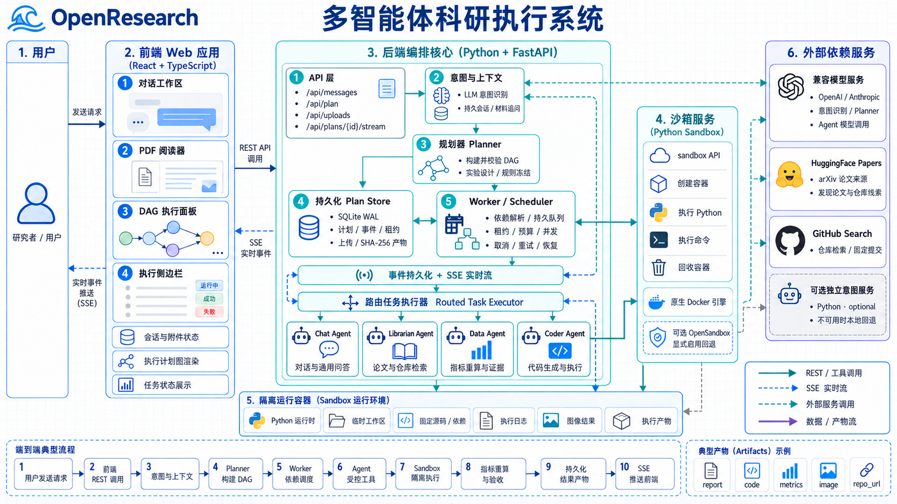
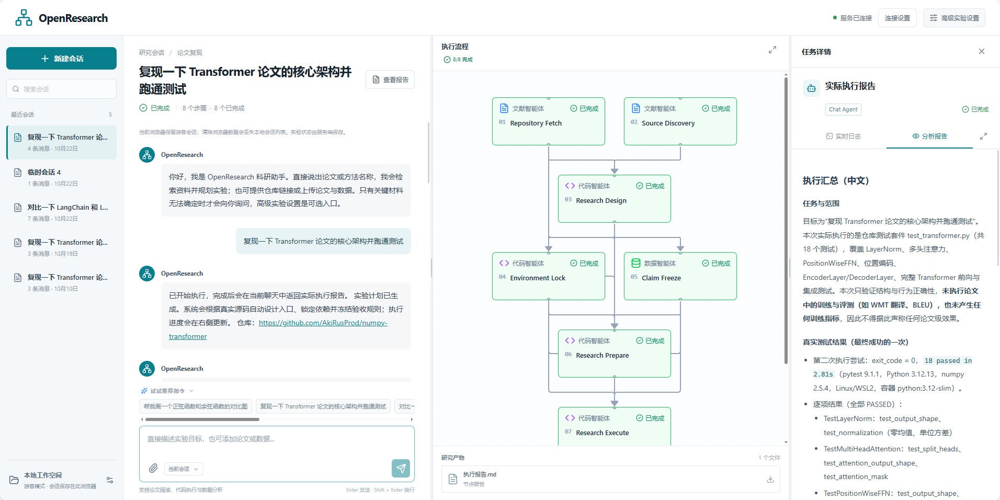
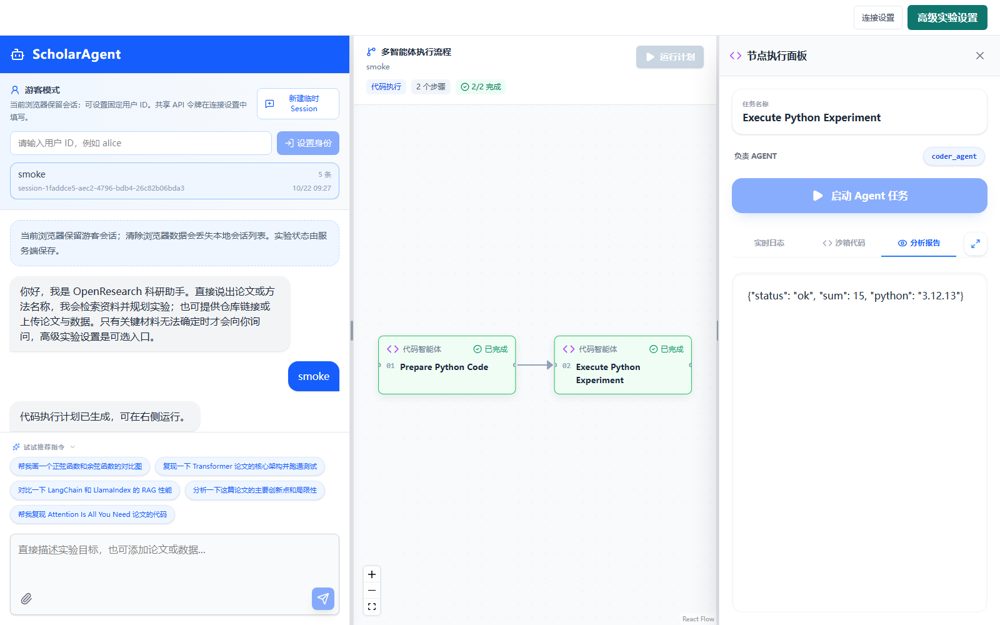

<div align="center">

# OpenResearch

**从论文理解到沙箱实验的多智能体科研执行系统**

[](pyproject.toml)
[](src/openresearch/api/)
[](frontend/)
[](compose.yaml)
[](LICENSE)
[](#project-status)

[快速开始](#quick-start) · [系统架构](#architecture) · [API](#api) · [实验记录](#reproduction) · [贡献指南](CONTRIBUTING.md)

</div>



OpenResearch 是 [AGI-OpenResearch](https://github.com/AGI-Core/AGI-OpenResearch) 的独立 Python 实现，面向论文阅读、代码仓库发现、环境准备、受控实验和结果分析等科研工作流。用户提交研究目标后，Planner 会生成并校验 DAG，持久 Worker 按依赖调度 Chat、Librarian、Coder 和 Data 等角色，在 Docker 沙箱中执行实验，并通过 SSE 将日志、状态和结构化产物实时推送到 React 工作台。

> [!NOTE]
> 本项目目前是具备持久化、恢复、审批、预算和受限沙箱能力的单机研究原型。共享令牌与客户端声明的用户 ID 面向可信本地使用，Docker socket 仍具有较高宿主机权限，部署前请阅读[项目状态与安全说明](#project-status)。



*新版科研工作台，展示会话导航、科研对话、执行流程与任务详情；示例为 Transformer 复现任务的执行进度和分析报告。*

## Why OpenResearch

| 能力 | 当前实现 |
|---|---|
| **面向科研的任务规划** | 将论文复现、代码执行、数据分析和框架对比等目标拆解为可执行 DAG |
| **专业 Agent 路由** | 根据任务类型分派 Chat、Librarian、Coder 或 Data，校验角色与工具权限 |
| **真实隔离执行** | 通过 Python 沙箱服务管理 Docker 容器，支持受控命令、文件传输和产物回传 |
| **仓库优先的论文复现** | 检索或使用指定 GitHub 仓库，固定完整提交 SHA，锁定依赖后运行实验 |
| **预算受限的消融设计** | ToT 评价候选的相关性、信息增益、风险与成本，只执行预算内的有限组合 |
| **研究材料上传** | 支持 PDF、配置、笔记和小型数据文件，保留资源归属、内容摘要与会话上下文 |
| **科研仓库 Coding Agent** | 在授权路径内生成适配器、调试代码、修复依赖和重跑，保留原始失败记录 |
| **自有数据仓库评测** | 独立小样本预检后执行 Benchmark，根据逐样本预测在服务端重算指标 |
| **逐主张复现验收** | 实验前冻结 Rubric，实验后把主张、规则、真实指标与 Artifact 哈希绑定成证据图 |
| **实时可观测执行** | SSE 推送计划、节点、日志和产物事件，支持游标回放与刷新恢复 |
| **可靠执行与治理** | SQLite 持久化、任务租约、迟到结果隔离、取消/重试、执行预算和人工审批 |
| **研究工作台** | 集成对话、PDF 阅读、DAG 看板、节点日志、代码、报告、图表和产物下载 |

<a id="quick-start"></a>

## Quick Start

### Prerequisites

- Docker Engine / Docker Desktop 的 Linux 容器与 Docker Compose v2
- Git
- 自然语言规划、聊天、代码生成和自动修复需要配置 OpenAI-compatible 或 Anthropic Messages 模型
- 本地源码开发需要 Python 3.12–3.14、uv 与 Node.js 22；Compose 镜像会构建前端和 Python 服务

显式提供代码的基础执行不需要模型密钥。公开检索、仓库和依赖下载需要相应网络。

### Start with Docker Compose

```bash
git clone https://github.com/lsd-ff/OpenResearch-Python.git
cd OpenResearch-Python

cp .env.example .env
# 编辑 .env，填写 OPENRESEARCH_LLM_API_KEY 和 OPENRESEARCH_LLM_MODEL
# 根据模型供应商调整 OPENRESEARCH_LLM_PROVIDER 与 OPENRESEARCH_LLM_BASE_URL

docker compose up --build -d
```

Windows PowerShell 可用 `Copy-Item .env.example .env` 复制配置。启动后访问：

| 服务 | 地址 |
|---|---|
| Web UI / Backend API | http://127.0.0.1:8080/ |
| OpenAPI Docs | http://127.0.0.1:8080/docs |
| Health Check | http://127.0.0.1:8080/api/health |
| Process Ping | http://127.0.0.1:8080/ping |

默认启动 API、Worker 和 Sandbox 三个服务，仅发布本机 `8080` 端口。API 与 Worker 共享 `research-data` 持久卷，只有 Sandbox 服务挂载 Docker socket；沙箱 HTTP 接口在 Compose 网络内提供，不单独发布宿主端口。

确认后端与沙箱均已就绪：

```bash
curl http://127.0.0.1:8080/api/health
```

期望响应中同时出现 `backend.ok=true` 与 `sandbox.ok=true`。启用 API token 后，请携带 Bearer token 或通过工作台“连接设置”认证。查看日志或停止服务：

```bash
docker compose logs -f api worker sandbox
docker compose down
```

`docker compose down` 默认保留数据卷。模型、代理及可选服务配置见 [Configuration](#configuration)。

### Try a Reproduction Plan

在 Web UI 新建会话并输入：

```text
复现一下 Transformer 论文的核心架构并跑通测试。
```

系统会检索实际来源、核验实现、固定源码与依赖，再生成并执行研究计划。也可直接提供仓库链接，例如“用 https://github.com/pallets/itsdangerous 做签名校验冒烟实验”。来源存在歧义时会保存追问，补充编号或链接后继续。

典型主链如下，实际节点由任务和材料决定：

```text
检索论文 / 仓库 -> 固定源码 -> 设计实验 -> 解析并锁定依赖
                              \-> 冻结主张 Rubric
    -> 准备运行时与代码 -> 预检 / 执行实验 -> 指标与主张评估
                                           -> 证据图与中文报告
```

可以上传 PDF 后发送“分析这篇论文”或“复现这篇论文”，也可提供公共 PDF 链接。明确要求“只规划”或启用审批时，计划等待后续执行。已有的单句 Transformer 验收记录见 [Reproduction](#reproduction)。

### Benchmark a Repository with Your Data

在 Web UI 上传 `CSV`、`TSV`、`JSON` 对象数组或 `JSONL`，然后输入：

```text
用 https://github.com/OWNER/REPOSITORY 跑 benchmark，
输入列是 review，标签列是 label，最多运行 500 条样本。
```

请替换为实际仓库地址。系统会确认数据契约、获取固定源码、生成适配器，并在正式运行前用最多 8 条样本独立预检。标签保留在评估端，实验只接收特征；分类和回归指标由服务端根据逐样本预测重算。

论文代码运行失败时，Coder 可在授权范围内提出补丁或依赖修复，并保留每次实际错误。代码、依赖或运行时变更后必须重新预检。输入、预测、补丁和验收规则见[实验协议](docs/experiments.md)与[环境恢复](docs/environment-recovery.md)。

## Interface

工作台集成对话、附件、PDF 阅读、DAG 和执行侧边栏。用户可直接描述研究目标，材料不足时通过聊天补充；高级实验设置用于手动指定仓库、入口、固定依赖、数据列映射和验收阈值。普通任务无需填写高级表单。

点击节点可以查看任务描述、负责 Agent、实时日志、生成代码、报告、指标和图表。产物支持预览与下载，PDF 引用核对实际页码；计划、会话和事件保存在服务端，刷新后可恢复。证据图按主张、规则和实际产物展示判定依据。



*Python 工程的真实 Docker smoke 网页回归截图；示例输出用于验证执行链路。*

上传数据后可直接要求统计与缺失值分析。发送“对比 LangChain 与 LlamaIndex 的 RAG 性能”可创建独立框架分支，共用数据与评测协议；“比较适用场景”则进行资料分析。详见[框架对比](docs/framework-comparison.md)、[输出产物](docs/output-artifacts.md)与[前端说明](frontend/README.md)。

<a id="architecture"></a>

## Architecture

```text
User / Researcher
       |
       v
React Workbench -- REST --> FastAPI / Intent / Session
       ^                           |
       | SSE                       v
       +------------------ SQLite Plan Store <--> DAG Planner
                                      |
                                      v
                             Worker / Scheduler
                                      |
                         +--------+--------+--------+
                         |        |        |        |
                        Chat  Librarian  Coder     Data
                                  |        |        |
                                  +--------+--------+
                                           |
                                  Python Sandbox Service
                                           |
                                    Docker Containers
                                           |
                                 Logs / Metrics / Artifacts
```

API 与 Worker 共享 SQLite 和本地数据目录，状态、事件与产物索引同事务提交。Worker 维护执行租约和累计预算，取消或过期后拒绝旧结果；浏览器关闭不会终止已排队的实验。

沙箱支持原生 Docker、独立 HTTP 服务及 OpenSandbox。Compose 默认由 Python 沙箱服务优先管理原生 Docker；OpenSandbox 是显式配置后启用的备用后端，仅在容器创建失败时尝试回退。它也可以基于 Docker 运行，具体基础设施由部署者配置。详细边界见[系统架构](docs/architecture.md)和[沙箱服务](docs/sandbox-service.md)。

### Core Components

| 组件 | 目录 | 职责 |
|---|---|---|
| Frontend | `frontend/` | React + TypeScript 工作台、DAG、PDF 与执行结果展示 |
| Backend | `src/openresearch/api/`、`services/` | FastAPI、会话、意图识别、上传、工作流提交与 SSE |
| Planner / Worker | `src/openresearch/planner/`、`scheduler/` | DAG 规划、依赖调度、租约、预算、恢复和取消 |
| Agents / Research | `src/openresearch/agents/`、`research/` | 角色路由、实验设计、代码修复、指标与证据评估 |
| Sandbox Service | `src/openresearch/sandbox/` | Docker / HTTP / OpenSandbox 适配、文件与容器生命周期管理 |
| Storage / Sources | `src/openresearch/storage/`、`sources/` | SQLite 与文件持久化、来源检索、源码及依赖获取 |
| Intent Service | `src/openresearch/api/intent_service.py` | 可选独立意图服务，通过 Compose `ai` profile 启用 |
| Documentation | `docs/` | 架构、协议、模型、部署和验收记录 |

### Agent Roles

| Role | Responsibility |
|---|---|
| **Chat** | 通用问答、带文档上下文的回答和引用校验 |
| **Librarian** | 论文解析、来源检索、仓库发现与论文分析 |
| **Coder** | 代码生成、依赖与运行时准备、受限补丁和沙箱执行 |
| **Data** | 数据统计、消融设计、指标重算、主张评估与报告生成 |

Sandbox 是执行服务。旧接口中的 Research、Sandbox 和 Research Coding 等角色经兼容映射接入上述角色，范围见[源码迁移复核](docs/go-migration-audit.md)与[旧接口说明](docs/legacy-api.md)。

<a id="api"></a>

## API

启动后可在 `/docs` 查看完整 OpenAPI。

| Method | Endpoint | Description |
|---|---|---|
| `GET` | `/api/health` | 检查后端与沙箱就绪状态 |
| `POST` | `/api/auth/session` | 使用 API token 换取浏览器认证 Cookie |
| `GET` | `/api/session` | 恢复当前会话、上传材料和计划历史 |
| `POST` | `/api/messages` | 统一聊天入口，返回回答、材料追问或计划 |
| `POST` | `/api/plan` | 创建并保存 DAG，支持显式工作流参数 |
| `GET` | `/api/plans/{id}` | 查询计划、节点状态和产物索引 |
| `POST` | `/api/plans/{id}/execute` | 启动整张计划图 |
| `POST` | `/api/plans/{id}/approve` | 批准需要人工确认的计划 |
| `POST` | `/api/plans/{id}/cancel` | 取消计划与活动任务 |
| `POST` | `/api/plans/{id}/tasks/{task}/execute` | 执行依赖已满足的单个节点 |
| `POST` | `/api/plans/{id}/tasks/{task}/retry` | 重置失败节点及后继，随后可重新执行 |
| `POST` | `/api/plans/{id}/tasks/{task}/reassign` | 将未开始节点分派给兼容角色 |
| `GET` | `/api/plans/{id}/events?after=0` | 分页读取计划事件历史 |
| `GET` | `/api/plans/{id}/stream?after=0` | SSE 订阅，支持 `Last-Event-ID` 回放 |
| `GET` | `/api/plans/{id}/artifacts/{artifact}/content` | 校验归属与 SHA-256 后读取产物 |
| `POST` | `/api/execute` | 受治理的执行兼容入口，支持 SSE |
| `POST` | `/api/uploads` | 上传论文、配置或小型 Benchmark 数据 |
| `GET` | `/api/uploads/{id}/content` | 读取所属上传文件 |
| `POST` | `/api/chat` | 通用对话接口 |
| `POST` | `/api/sources/search` | 检索论文或仓库 |
| `GET` | `/api/pdf-proxy?url=...` | 下载并校验公共 HTTP/HTTPS PDF |

显式工作流的 `/api/plan` 仅创建计划，需要另行排队；统一消息入口按执行意图、审批设置和预算决定是否自动执行。请求字段、状态码与认证方式见 [HTTP 契约](docs/api.md)。

## Configuration

复制 [.env.example](.env.example) 为 `.env` 后配置。环境变量统一使用 `OPENRESEARCH_` 前缀，由 `src/openresearch/config.py` 读取；API、Worker 与沙箱需要保持相关配置一致。

| Variable | Required | Default / Purpose |
|---|---:|---|
| `OPENRESEARCH_LLM_API_KEY` / `OPENRESEARCH_LLM_MODEL` | 模型功能需要 | 模型密钥与实际模型名称，默认空 |
| `OPENRESEARCH_LLM_PROVIDER` | No | `openai`；也支持 `anthropic` |
| `OPENRESEARCH_LLM_BASE_URL` | No | 默认 `https://api.openai.com/v1`，按供应商与协议调整 |
| `OPENRESEARCH_DATA_DIR` | No | 源码默认 `.data`；Compose 内为 `/data` |
| `OPENRESEARCH_PORT` | No | 工作台端口，默认 `8080` |
| `OPENRESEARCH_WEB_DIR` | No | 模板设置为 `frontend/dist`；Compose 使用镜像内网页 |
| `OPENRESEARCH_SANDBOX_BACKEND` | No | 源码默认 `docker`；支持 `http`、`opensandbox`、`auto`；Compose API/Worker 固定为 `http` |
| `OPENRESEARCH_SANDBOX_URL` / `OPENRESEARCH_SANDBOX_TOKEN` | No | HTTP 沙箱地址与凭据；Compose 地址为 `http://sandbox:8082` |
| `OPENRESEARCH_SANDBOX_IMAGE` | No | 默认实验镜像 `python:3.12-slim` |
| `OPENRESEARCH_SANDBOX_MEMORY` / `OPENRESEARCH_SANDBOX_NETWORK` | No | 默认 `1g`、`none`，限制内存与实验网络 |
| `OPENRESEARCH_RUNTIME_PROFILES` | No | 默认 `{}`；管理员注册可用 Python 版本、CPU / GPU 镜像与资源 |
| `OPENRESEARCH_TASK_TIMEOUT_SECONDS` / `OPENRESEARCH_PLAN_TIMEOUT_SECONDS` | No | 默认单任务 `600` 秒、单计划 `2400` 秒 |
| `OPENRESEARCH_MAX_TASK_ATTEMPTS` / `OPENRESEARCH_MAX_CONCURRENT_TASKS` | No | 默认累计 `100` 次节点尝试、并发 `2` |
| `OPENRESEARCH_CODE_MAX_REPAIRS` | No | 默认 `2`；设置为 `0` 关闭普通代码自动修复 |
| `OPENRESEARCH_REQUIRE_APPROVAL` | No | 默认 `false`；启用后要求执行前人工审批 |
| `OPENRESEARCH_API_TOKEN` | No | 非空时启用静态 Bearer / HttpOnly Cookie 认证 |
| `OPENRESEARCH_SOURCE_PROXY_URL` | No | 公开检索、PDF 与依赖下载的可选来源代理 |
| `OPENRESEARCH_INTENT_SERVICE_URL` | No | 默认空，使用进程内识别；独立服务可设为 `http://intent:8083` |
| `OPENRESEARCH_SANDBOX_FALLBACK_ENABLED` | No | 默认 `false`；启用 OpenSandbox 回退 |
| `OPENRESEARCH_OPENSANDBOX_URL` / `OPENRESEARCH_OPENSANDBOX_API_KEY` | No | 已部署的 OpenSandbox 服务地址与凭据 |

以上为应用配置。Compose 实际传入的字段以 [compose.yaml](compose.yaml) 的 `environment` 为准，未列入服务环境的参数需要同步配置。

启用独立意图服务时，在 `.env` 设置 `OPENRESEARCH_INTENT_SERVICE_URL=http://intent:8083`，再运行：

```bash
docker compose --profile ai up --build -d
```

GPU 运行需要管理员注册命名运行时、准备兼容镜像，并满足实际容器资源准入。默认 1 CPU / 1 GiB 环境用于小型 CPU 实验；GPU 与 full 模式不会自动突破资源和预算限制。详细配置见[运行时选择](docs/runtime-profiles.md)、[模型说明](docs/models.md)、[公共 PDF 与代理](docs/remote-pdf.md)和[意图服务](docs/intent-service.md)。

## Development

在 Python 工程根目录安装依赖并执行检查：

```bash
uv sync --locked
npm --prefix frontend ci

uv run --locked python scripts/check.py
npm --prefix frontend run lint
npm --prefix frontend run build
```

后端门禁包含 Ruff、格式检查、严格 mypy、非 Docker 测试和 sdist/wheel 构建。首次从源码启动，在已有 `.env` 和前端构建的情况下运行：

```bash
uv run --locked openresearch doctor
uv run --locked openresearch db upgrade
uv run --locked openresearch app
```

`app` 一次启动工作台、API、持久 Worker 和本地 HTTP 沙箱，默认访问 `http://127.0.0.1:8080/`。Ctrl+C 触发任务、容器和服务清理。

开发时也可在不同终端分别运行以下命令；API 与 Worker 需要相同的数据目录和沙箱配置：

```bash
# 终端一：API
uv run --locked openresearch serve
# 终端二：Worker
uv run --locked openresearch worker
# 终端三：前端热更新
npm --prefix frontend run dev
```

真实 Docker 与外部来源测试需显式开启：

```bash
OPENRESEARCH_TEST_DOCKER=1 uv run --locked pytest -m docker
OPENRESEARCH_TEST_DOCKER=1 OPENRESEARCH_TEST_EXTERNAL=1 uv run --locked pytest -m docker
```

PowerShell 使用 `$env:OPENRESEARCH_TEST_DOCKER = '1'` 等环境变量语法后运行对应命令。网页回归入口为 `npm --prefix frontend run test:e2e`，需准备测试配置、浏览器和 Docker。

构建单文件服务时，在目标操作系统上安装 release 依赖并打包：

```bash
uv sync --locked --group release
uv run --locked --group release python scripts/build_release.py
```

发行物内嵌网页、Python 运行时与 uv。Windows 输出 `dist/release/openresearch.exe`，Linux 输出 `dist/release/openresearch`；目标机器仍需 Docker 和相应外部服务配置。构建前需安装前端依赖，独立运行、配置与退出验收见[单文件发行](docs/release.md)。

## Reproduction

项目包含可审计的轻量论文复现与工程验收记录，用于验证执行链、核心结构和结果可追溯性。以下是已有文档中的历史结果，重新运行以当次实际回执为准。

从 [examples](examples/) 与[实验协议](docs/experiments.md)开始，可运行 `scripts/verify_deployment.py` 验证真实沙箱、指标重算、消融和产物下载。真实模型与自动规划联调分别使用 `scripts/verify_framework.py`、`scripts/verify_auto_planning.py`，需要对应服务、模型与网络配置。

| Record | Execution Boundary | Result |
|---|---|---|
| [单句 Transformer 与整合验收](docs/local-verification-2026-10-21.md) | 空白会话 -> 自动检索与 DAG -> 实际 Docker -> 中文报告 | 8/8 节点完成，18 项原始测试通过，3 项功能规则验证 |
| [早期 Transformer 对话验收](docs/transformer-chat-acceptance.md) | 独立的 2026-10-19 单句对话回执 | 18 项测试通过，保存来源、依赖、执行输出与产物哈希 |
| [显式脚本 Transformer 复跑](docs/transformer-reproduction.md) | 已提供脚本后的论文解析、数值/梯度检查与小规模训练 | 与单句自动规划分别记录，可用 `scripts/verify_transformer.py` 复跑 |
| [OpenSandbox 真实回退验收](docs/framework-verification.md) | 主后端创建失败 -> OpenSandbox -> 程序 / 文件 / 清理 | 验证真实执行、输出、非零退出码、文件往返与沙箱删除 |
| [Linux 原生发行验收](docs/linux-native-verification-2026-10-22.md) | WSL2 Ubuntu 24.04 x86_64 构建并实际运行 ELF | 870 项默认测试通过；真实 Docker 专项、退出及重启恢复通过 |

Transformer 核心测试未执行 WMT 完整训练或 BLEU 复现。协议样例、合成数据和小型 CUDA 验收各有明确范围，不能外推为论文效果或大型训练能力。历史失败、修复与跳过项保留在对应记录中。

## Project Layout

```text
OpenResearch-Python/
├── README.md
├── LICENSE
├── pyproject.toml                 # Python 包、CLI 与检查配置
├── uv.lock                        # 固定依赖锁
├── frontend/                      # React + TypeScript 工作台
├── src/openresearch/
│   ├── api/                       # FastAPI、SSE 与可选意图服务
│   ├── services/                  # 会话、意图和业务入口
│   ├── planner/                   # DAG 与实验规划
│   ├── scheduler/                 # 持久 Worker 与调度
│   ├── agents/                    # 四类 Agent 与角色路由
│   ├── research/                  # 实验、修复、指标和证据
│   ├── sources/                   # 检索、仓库、PDF 与依赖
│   ├── sandbox/                   # Docker / HTTP / OpenSandbox
│   ├── storage/                   # SQLite、迁移与文件持久化
│   ├── executor/                  # 底层执行与资源控制
│   ├── checkpoint/                # 检查点与生命周期
│   ├── watchdog/                  # 执行监测
│   ├── distribution/              # 一体化启动与发行资源
│   └── config.py                  # 统一配置
├── tests/                         # 单元、集成、验收与端到端测试
├── examples/                      # 实验入口与可运行示例
├── docs/                          # 架构、协议、截图和验收记录
├── scripts/                       # 检查、联调、验收与打包
├── packaging/                     # 单文件打包入口
├── .env.example
├── compose.yaml                   # API / Worker / Sandbox / 可选 Intent
└── Dockerfile
```

## Documentation

- [项目架构](docs/architecture.md)
- [框架对齐验收](docs/framework-parity.md)
- [源码迁移复核](docs/go-migration-audit.md)
- [阶段实施计划](docs/implementation-plan.md)
- [HTTP API 契约](docs/api.md)
- [旧接口兼容说明](docs/legacy-api.md)
- [模型配置与联调](docs/models.md)
- [可运行示例](examples/)
- [实验协议、Benchmark 与消融](docs/experiments.md)
- [框架对比](docs/framework-comparison.md)
- [代码自动恢复](docs/code-recovery.md)
- [环境与依赖恢复](docs/environment-recovery.md)
- [沙箱服务与 OpenSandbox](docs/sandbox-service.md)
- [运行时、GPU 与资源准入](docs/runtime-profiles.md)
- [Docker 持久终端与检查点](docs/docker-core.md)
- [PDF 来源与代理](docs/remote-pdf.md)
- [输出产物与下载](docs/output-artifacts.md)
- [独立意图服务](docs/intent-service.md)
- [前端接入与设计](docs/frontend-design.md)
- [单文件构建与发行](docs/release.md)
- [框架验证记录](docs/framework-verification.md)
- [本地整合验收](docs/local-verification-2026-10-21.md)
- [Linux 原生发行验收](docs/linux-native-verification-2026-10-22.md)
- [历史验证记录](docs/verification.md)
- [贡献指南](CONTRIBUTING.md)

<a id="project-status"></a>

## Project Status

- **Research prototype**：接口和数据结构仍可能调整，当前面向单机科研实验与可信本地使用者。
- **Persistent single-node runtime**：SQLite WAL 保存计划、会话、事件、租约和产物索引；当前不支持跨主机 Worker 或分布式数据库部署。过期任务可以恢复，实验可能重复执行，不承诺 exactly-once。
- **Authentication**：支持静态 API token、HttpOnly Cookie 与资源归属检查；客户端声明的用户 ID 不提供独立账号认证。
- **Sandbox privilege**：原生 Docker 默认 1 CPU、1 GiB 内存、64 进程、非 root、只读根目录和无网络；`/tmp` 为 256 MiB 内存盘，`/workspace` 为 1 GiB 内存盘。Docker socket 仍具有较高宿主权限。
- **Reproducible sources**：仓库限定 HTTPS GitHub 并固定完整提交 SHA；依赖精确锁定版本、校验 wheel 哈希后离线安装。默认实验目标为 CPython 3.12，命名配置支持 3.11/3.12/3.13、Linux x86_64；不执行源码包构建或仓库安装脚本。
- **GPU / full runtime**：支持注册 GPU 配置、资源探测与准入；默认 CPU 环境不满足完整训练条件，小型 CUDA 测试不证明大型论文训练效果。
- **Documents and evidence**：当前没有 OCR；缺失文本页保留状态。数值指标由服务端重算，语义评估受实际证据引用约束；缺少证据时不判为已验证。
- **Verification scope**：已有 Windows 与指定 WSL2 Linux 环境的本地验收记录；其它发行版、libc 或 ARM 未由这些记录覆盖。仓库包含 CI 配置，最新远端状态以实际 GitHub Actions 运行记录为准。

## Contributing

欢迎提交 Issue、文档改进、测试和范围清晰的 PR。修改前阅读[贡献指南](CONTRIBUTING.md)与工程中的 [code_skill](.trae/skills/code_skill/SKILL.md)，提交前运行：

```bash
uv run --locked python scripts/check.py
npm --prefix frontend run lint
npm --prefix frontend run build
```

模型密钥、`.env`、运行数据库、实验产物、虚拟环境和构建产物不应提交。更详细的模块边界、测试和迁移约定见[贡献指南](CONTRIBUTING.md)。

## License

OpenResearch 使用 [MIT License](LICENSE)。
