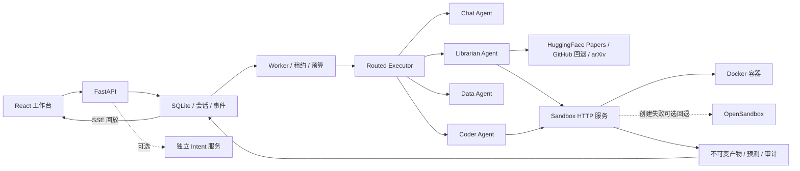

# Python 重写架构

## 进程与边界

FastAPI、持久 Worker、Sandbox HTTP 服务独立运行；可选独立 Intent 服务通过 Compose ai profile 启用。API 与 Worker 共享本地 SQLite 和数据目录；只有 Sandbox 服务挂载 Docker socket。API 保存已校验 DAG；Worker 领取任务、维护租约并调用 Agent。关闭浏览器不会终止实验。当前不支持跨机器 Worker 或 PostgreSQL。

api 处理 HTTP、认证和序列化；services 处理提交与上下文；planner 声明和验证图；scheduler 调度与执行分离；agents 编排业务工具；research 处理补丁、数据协议、指标及验收；sources 获取受限来源；storage 处理事务与文件；只有 sandbox 持有 Docker 客户端。

ExecutionLease 聚合 plan/task/execution/worker 身份，TaskCompletion 聚合完成结果。状态更新、事件和产物索引共用事务。任务声明工具权限、输入产物、输出产物和超时。

PlannerAgent 根据意图、实际附件和受支持能力构建 DAG，允许增加检索、数据和结果汇总分支、分派角色、指定依赖与优先级。模型不得覆盖基础阶段的源码、资产、权限或产物契约；图、角色或模型输出无效时回退标准工作流，并记录 planning.strategy/reason。四类 Agent 根据角色路由执行，旧 research/sandbox 角色在边界兼容。

Data Agent 对实际 CSV/TSV/JSON/JSONL 计算有限统计与缺失值图。Coder 的独立代码节点自动收集 /workspace/artifacts 内的文件，保留内容哈希、类型和图像预览，供网页显示及归属校验后的下载；详情见 [output-artifacts.md](output-artifacts.md)。独立沙箱与可选识别服务配置分别见 [sandbox-service.md](sandbox-service.md)、[intent-service.md](intent-service.md)。

## 实验链

聊天统一进入 MessageService；IntentParser 提出结构化意图，AutoPlanner 校验上传、数据列和来源，PlanningSources 只使用真实链接与检索结果。材料不足保存 PendingPlanning，补充短答可继续。会话消息、追问状态和新图同事务提交，冲突不留下孤立计划。执行时发现缺少仓库，Worker 仅为该会话最新失败计划设置材料追问。

自动图先取得固定源码，再由 ResearchDesigner 提出入口、参数、补丁范围和依赖。可信 uv 禁用源码构建及外部配置，将版本范围解析为固定版本；随后原有 wheel 哈希和离线安装契约继续校验。resolved_research 从不可变 research_spec 产物统一读取实际设计，准备、执行与修复使用相同参数。论文分析核对模型引用与实际解析页。

代码计划包含准备与执行；论文解析输出 paper.corpus/v1 和来源索引。研究计划按需准备文档、仓库、环境，随后冻结 claim.rubric/v1、准备 research.patch/v1、运行实验，产生 research.report/v1 和 claim.evidence/v1。

模型提出结构化代码、补丁或语义判断；系统校验契约、路径、基础 SHA、补丁范围、语法、预测覆盖率与证据引用。源码、附件和模型内容作为不可信材料。代码仅在实验容器中执行。

模型边界统一提供 Pydantic JSON Schema，支持 OpenAI JSON response_format 和 Anthropic Messages；Anthropic 可用单一 submit_response 输入契约返回数据，不执行模型返回的工具调用。格式修正共用一次模型总期限，输入、输出与 token 各自受限。API 与 Worker 从相同配置读取协议、模型、预算和密钥；前端不接收模型密钥。配置见 [models.md](models.md)。

Benchmark 根据列映射分离特征和目标，要求每个样本恰好一个预测。指标在服务端计算，拒绝重复、缺失、未知样本及非有限值。基线修复有界，每次使用新容器；消融复用最终代码快照，分别传入参数。报告保存累计补丁、各次输出、数据摘要、依赖锁摘要、实际安装版本及 Docker image ID，便于回放。

标准在实验前冻结并校验摘要。数值主张只能读取校验后的指标；语义判断逐条引用存在的执行证据，无模型、引用无效或运行失败均不能判为已验证。缺少资产与结果矛盾分别记录。结论只覆盖声明的数据、参数和环境。

语义评估输入只保留最终运行尝试与重算指标，排除源码补丁和早期失败输出；评估引用还须在原始不可变报告中存在。模型错误脱敏后返回，并按类别记录；浏览器聊天等待时间覆盖模型预算上限。

## 状态、事务与恢复

SQLite 使用 BEGIN IMMEDIATE 写锁，跨进程领取与并发预算由数据库判断。每次尝试有独立 ID 与租约；提交必须匹配当前 Worker 和有效租约。

计划 JSON 是独立 aggregate，最多 64 节点；attempt、事件、产物、沙箱、上传和会话分表。Alembic 在启动写锁内升级；新增能力使用后续 revision，不修改 0001。

过期尝试重新排队，旧结果不能提交。取消失效租约并回收容器；失败重试使相关下游和当前产物引用失效，历史索引保留。整图和单节点执行共用状态机，单节点不自动执行未选后继。

沙箱创建、执行连接和清理受取消保护，确保阻塞 SDK 返回的资源能被关闭。持久 runtime namespace 区分不同数据卷；Worker 对账本 namespace 容器，保留有效尝试、回收超宽限期孤立资源。产物 GC 与结果提交共用写锁，仅删除超宽限期、无引用且无有效尝试的文件。

## 文件、来源与会话

上传限制类型、体积和文件名，记录归属及 SHA。PDF 在容器中逐页解析，限制页数、解压流和文本体积；空白页标记 OCR 状态。聊天使用有界的历史、计划与来源页；提交比较会话 revision，拒绝并发覆盖。

仓库固定提交归档仅在服务内存中读取普通文件，不调用宿主机 git hook、安装脚本或项目入口。wheel 从固定 PyPI 域获取，校验平台、版本、Python 要求、依赖闭包及 SHA，在无网络容器中按锁安装。源码与 wheel 按内容摘要缓存。

## 产品与部署

独立 React 工作台沿用 DAG 和证据图契约，增加实验配置、认证连接与上传 PDF 阅读。浏览器刷新从 API 恢复计划状态；浏览器本地会话和服务端上下文分别持久化。切换身份创建新会话，避免引用其他身份的资源。

Dockerfile 构建前端与 Python runtime；Compose 独立启动 API/Worker，共享数据卷和管理用 Docker socket，仅发布本机端口。当前是本地可信模式，身份字段不是公网账号认证。GPU 训练、OCR、依赖源码构建和跨主机调度未纳入本版本。
