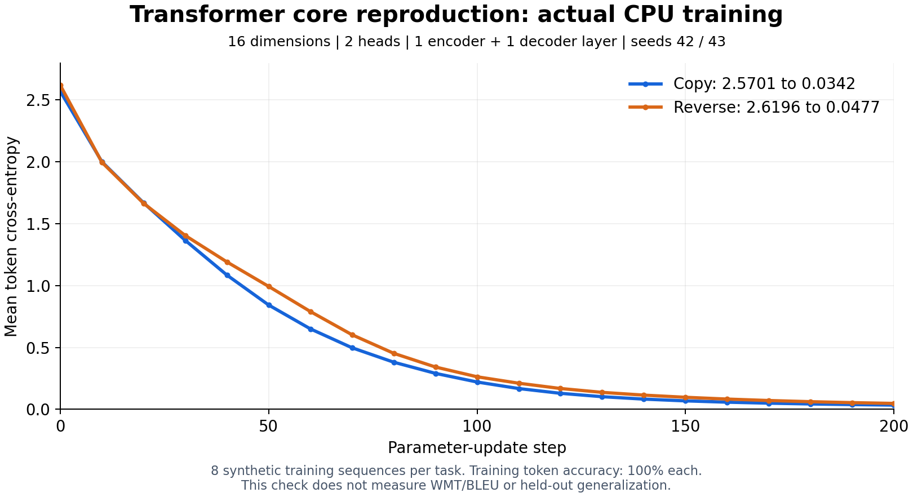

# Transformer 核心复现实测

2026-10-19 已完成一次从原论文、固定源码、依赖锁定、预先冻结准则、容器执行到报告汇总的完整复跑。最终计划 `60aae4538374482e85a9da01937af7ed` 为 completed，模型规划 strategy=llm，7/7 节点成功，程序退出码 0，3/3 功能准则有实际执行证据。DAG 执行时间为北京时间 12:10:40–12:12:13，约 93 秒，不含此前规划时间。

工作台结果：[打开执行记录](http://127.0.0.1:8080/?plan=60aae4538374482e85a9da01937af7ed)。链接沿用浏览器当前身份，服务端检查资源归属。

## 复现范围与来源

- 论文：[Attention Is All You Need](https://arxiv.org/abs/1706.03762)，实际下载并在容器内解析 15 页。PDF SHA-256 为 `bdfaa68d8984f0dc02beaca527b76f207d99b666d31d1da728ee0728182df697`。
- 源码：[AkiRusProd/numpy-transformer](https://github.com/AkiRusProd/numpy-transformer/tree/656470af9a5a13cb43975e148085a0aeadb87fda)，固定提交 `656470af9a5a13cb43975e148085a0aeadb87fda`。真实导入 Encoder、Decoder、MultiHeadAttention、PositionalEncoding，报告记录 `/tmp/openresearch/repository/transformer/...` 路径。
- 模型为 d_model=16、2 个注意力头、1 层 encoder、1 层 decoder、d_ff=32、词表 12、dropout=0。每个训练任务使用 8 条合成序列，source 长度 4、target 长度 5（含 EOS），copy/reverse 分别使用种子 42/43。
- 用有界 SGD 验证实际反向传播和参数更新，未复刻论文 Adam/Noam、完整规模训练或 WMT 数据。100% 是训练 token 准确率，没有验证集、测试集或 BLEU 结果。图中的 3 项准则是本次功能验收条件，不是原论文全部科学主张。

## 实测结果

| 训练任务 | 更新步数 | 初始交叉熵 | 最终交叉熵 | 训练 token 准确率 | Encoder embedding 变化范数 |
| --- | ---: | ---: | ---: | ---: | ---: |
| copy | 200 | 2.5701039092 | 0.0341553613 | 100% | 0.4772477529 |
| reverse | 200 | 2.6195920152 | 0.0476583710 | 100% | 0.5991351639 |



曲线来自原始执行输出，每 10 步记录一次。[原始数值 JSON](../examples/transformer_cpu/observed-result.json) 和 [可导出的 SVG](assets/transformer-cpu-loss.svg) 已保存。前一次实际代码运行与最终完整复跑的结果逐字段一致。

| 核心验证 | 实际结果 |
| --- | --- |
| 每个 head 的缩放点积注意力独立公式对照 | 最大误差 `1.1102230246251565e-16` |
| 多头拼接及输出投影 | 输出形状 `[2,5,16]`，与独立计算一致 |
| 正弦位置编码 | 最大误差 `4.440892098500626e-16` |
| 因果 attention mask | 未来 token 权重为 0；改变未来输入不改变前缀输出 |
| Encoder/Decoder 前向 | memory `[2,4,16]`，logits `[2,5,12]`，数值有限 |
| Decoder 因果性 | 改变后续目标 token 后，前缀 logits 保持一致 |
| Cross-attention 来源依赖 | 改变源序列，输出最大变化 `0.5394490720` |
| 训练与真实参数更新 | 两任务损失下降超过 30% 的预设门槛，Encoder 参数实际变化 |

## 上游梯度问题及局部修正

测试脚本先在原始组件上运行有限差分，再应用局部修正并再次核对。没有将原始错误结果写成成功。

| 梯度 | 修正前最大误差 | 修正后最大误差 |
| --- | ---: | ---: |
| Softmax | 0.2534547651 | `1.7634838034e-11` |
| LogSoftmax | 0.9710448854 | `7.4890038615e-11` |
| CrossEntropy | 0.3333333333 | `8.9185325791e-12` |

Softmax/LogSoftmax 在激活反传中额外除以 batch size，导致重复平均；适配器仍调用原反传，再补偿该因子。CrossEntropy 原实现用数值是否出现选择目标梯度，相同 logits 会错误选择多个位置；适配器改为按样本/类别索引构造梯度。修正位于公开的测试适配脚本中，通过有限差分核对；未修改或推送第三方仓库。

## 本次修复与失败记录

实际运行发现并修复了：

1. HF 返回不相关仓库后过早追问：继续查询真实标题及 GitHub，并优先采用明确的来源纠正。
2. 大型 wheel 下载和空间预算不足：增加有界配置、下载期限与内容摘要缓存。
3. HTTP 沙箱按 32 KB 多次执行写文件：增加校验归属、路径、类型、条目及总大小的批量 tar 传输。
4. pip 临时解压填满输入 tmpfs：在 `/workspace` 内解压，保留离线安装与 wheel 哈希校验。
5. NumPy 原生扩展不能映射：工作区显式启用 exec，`/tmp` 继续 noexec；真实加载原生扩展回归覆盖两者。
6. GitHub 匿名元数据 API 限流：完整 SHA 直接下载固定归档，浮动引用仍先解析提交。
7. 大段补丁源码截掉最终 stdout、JSON 转义破坏引用、汇总误用 PDF 引用：改为最终执行字段和解码日志投影，执行汇总使用禁止 PDF 引用的独立响应契约。普通论文问答仍逐字核对页码和原文。

第一份模型代码初稿只有 `placeholder`，没有被当作成功。最终使用的是经审查并公开保存的完整测试脚本。旧计划 `f567920e9d494d6294aec353ad1e9bca` 和 `d7a780adee4c49a0ac63aaf2dc0b03dc` 的失败、尝试与事件保留；后者曾实际完成代码测试，但报告引用失败。最终计划是修复后重新建立的完整 7 节点执行，未改写旧失败记录。

## 环境、复跑与工程检查

实际环境：Python 3.12.13、NumPy 2.0.2、Numba 0.60.0、llvmlite 0.43.0；Linux x86_64、1 CPU 配额、1 GiB 内存。沙箱基础镜像 ID：`sha256:57cd7c3a7a273101a6485ba99423ee568157882804b1124b4dd04266317710de`。输入 tmpfs 256 MiB、工作区 512 MiB，根目录只读，非 root，无实验出站网络。

测试脚本 SHA-256：`20a8cc71e742c8cf44f279644bcddd7763d1994ccec52a1e72827193528ea1b3`；与最终 final_patch 中实际执行的内容一致。

本机 `.env` 已配置以下实验预算；新环境可在自己的 `.env` 设置后重启 Compose：

```dotenv
OPENRESEARCH_SANDBOX_MEMORY=1g
OPENRESEARCH_SANDBOX_TMPFS_SIZE_MB=256
OPENRESEARCH_SANDBOX_WORKSPACE_SIZE_MB=512
OPENRESEARCH_DEPENDENCY_MAX_BYTES=134217728
OPENRESEARCH_SOURCE_DOWNLOAD_TIMEOUT_SECONDS=300
```

从项目目录运行：

```powershell
docker compose --profile ai up -d --build
uv run --locked python scripts/verify_transformer.py
```

驱动脚本仅负责 API 调用、产物哈希核对与结果保存，实验代码由 Worker 送入沙箱执行。可用 `--paper-file` 复用已有原论文 PDF、`--plan-id` 读取已有计划、`--user-id` 和 `--session-id` 指定归属。默认使用当前模型做 DAG、语义证据和汇总，会调用配置的供应商。`--planning-mode template` 可省去模型 DAG 规划，不会改写实验结果。

最终完整回执在忽略路径 `.data/transformer-acceptance/transformer-final-20261019/`，包含原论文、图、事件、依赖锁、源码快照索引、实际补丁、完整 stdout/stderr、结果 JSON、证据图和模型汇总。模型/代理密钥及私有运行数据不提交。

工程检查：257 项工程测试、22 项真实 Docker/外部验收、8 项 Chromium 网页回归通过；Ruff、严格 mypy、sdist/wheel、前端 lint/build 通过。实际脚本见 [verify.py](../examples/transformer_cpu/verify.py)，驱动见 [verify_transformer.py](../scripts/verify_transformer.py)。
